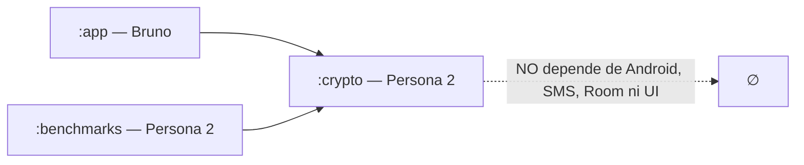
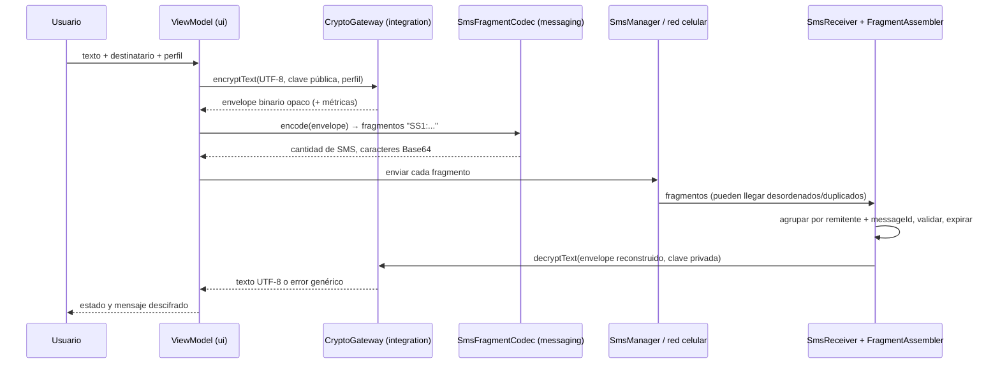

# Arquitectura del frente Android — SecureSMS

Estado: **PROPUESTA** salvo que se marque `OBSERVADO`. Nada de esto está implementado al 2026-11-21. Esta copia existe para sobrevivir a una compactación del contexto; la fuente normativa sigue siendo el contrato v0.2 en PDF.

## 1. Frontera de módulos (`OBSERVADO` del contrato)



- `:app` entrega texto UTF-8 y recibe bytes opacos; nunca ve campos del envelope.
- `:crypto` nunca recibe números telefónicos ni fragmentos SMS.
- Un repositorio, Gradle Kotlin DSL (`settings.gradle.kts`, `build.gradle.kts`).

## 2. Paquetes propuestos

```text
com.securesms.app
├── ui/           # Compose, ViewModel, UiState, formatos de error en español
├── messaging/    # SmsSender, SmsReceiver, SmsFragmentCodec, FragmentAssembler
├── storage/      # ContactKeyRepository, FragmentStore, MessageStore
├── keys/         # Android Keystore, importación de SPKI, huella SHA-256
└── integration/  # CryptoGateway (adaptador de MessageCrypto), FakeCryptoGateway (solo demo/tests)
```

Arquitectura deliberadamente ligera: **Compose + ViewModel**, sin Room, sin DI pesado, sin navegación elaborada. Se añade complejidad solo cuando una prueba la exija.

## 3. Flujo emisor y receptor (`OBSERVADO` del contrato)



**Regla:** no se llama a `decrypt()` con un ensamblado incompleto. Nunca.

## 4. Contratos internos propuestos (distintos de la API de `:crypto`)

- `CryptoGateway`: fachada delgada sobre `MessageCrypto` y `PublicKeyCodec`. Expone `encryptText`/`decryptText`, importación de claves y huellas. La UI no manipula `ByteArray` del envelope salvo para métricas.
- `SmsFragmentCodec`: `encode(envelope: ByteArray): List<String>` y `decode(parts): ByteArray?`. Dueño exclusivo del prefijo `SS1:`.
- `FragmentAssembler`: clave de agrupación `(remitente, messageId)`; índices desde 1; duplicados idénticos tolerados, contradicciones rechazadas, incompletos expirados; límite de 99 partes y techo de memoria.
- `ContactKeyRepository`: vínculo número → perfil → clave pública importada → estado de verificación de huella.
- `CryptoGateway` real vs `FakeCryptoGateway`: el falso queda aislado en `integration/`, se etiqueta en UI/logs como **modo demo** y se retira al integrar `:crypto`. No finge seguridad.

`SmsFragmentCodec` y `FragmentAssembler` se pueden implementar y probar con bytes opacos antes de que exista `:crypto`.

## 5. Estados de la UI (`OBSERVADO` del contrato, nombres propuestos)

`preparando` → `cifrado` → `enviando` → `aceptadoParaEnvio` → `recibido/reconstruido` → `error`.

Distinciones obligatorias en la interfaz:
- «aceptado por el sistema de SMS» ≠ «recibido por el destinatario» ≠ «descifrado correctamente».
- «clave importada» ≠ «clave verificada por huella en canal independiente».

## 6. Almacenamiento propuesto

- Claves privadas: Android Keystore donde el proveedor lo permita; fallback local acordado con Persona 2, nunca exportado a SMS ni logs.
- Claves públicas y asociaciones: almacenamiento interno privado (sin base de datos para el MVP).
- Fragmentos: en memoria con expiración; persistir solo si la recepción asíncrona/reinicios lo exige.
- Historial: mínimo; evitar guardar texto en claro salvo decisión documentada de demo.

## 7. Puntos abiertos que pueden cambiar esta arquitectura

1. Congelamiento v1 del contrato con Persona 2 y copia en `docs/contract.md`.
2. Sintaxis exacta del fragmento SMS (ancho fijo de índices, caracteres permitidos, expiración).
3. Compatibilidad real de Android Keystore con RSA-OAEP-SHA256 y ECDH en el dispositivo.
4. Vectores binarios de Persona 2 por perfil para las pruebas de integración JVM ↔ Android.

## 8. Reglas inviolables (`OBSERVADO` del contrato)

- No implementar RSA, ECC, AES, ECDH, HKDF ni el serializer del envelope en `:app`.
- No inventar perfiles ni cambiar la API pública sin acuerdo.
- No backend, login, Firebase, Internet, certificados ni servidor de claves.
- No afirmar prueba física con SIM si no se hizo; no medir red como tiempo criptográfico.
- Comentarios en español, sin emojis, KDoc en API pública, secretos fuera de logs y evidencia.
