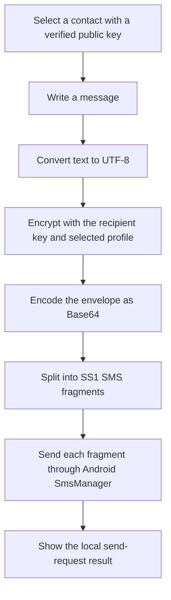
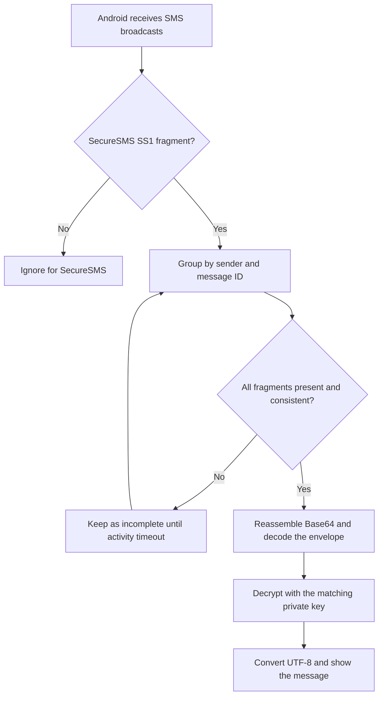
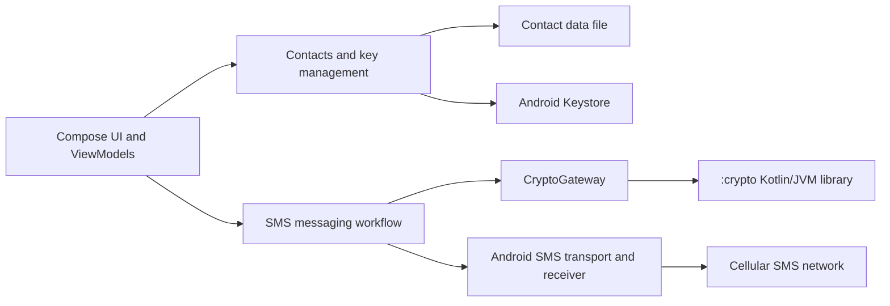

# SecureSMS

SecureSMS is an Android prototype for exchanging encrypted text messages over the cellular SMS network. It combines a native Android application with a platform-independent Kotlin/JVM cryptography module. The project is an academic demonstration of secure messaging and the practical costs of transporting encrypted payloads as SMS; it is not intended to replace a production messaging application.

## Main Objective

The main objective is to let two Android users exchange text messages encrypted for the recipient's public key, then measure how cryptographic profile and envelope size affect the number of SMS fragments required. The application uses real SMS transport; it does not send messages through an Internet service or backend.

The Android app provides contact and public-key management, fingerprint verification, SMS permissions and transport, fragment reassembly, and message status. Cryptographic operations are delegated to `:crypto`, which is independent of Android and SMS APIs.

## Supported Cryptographic Profiles

| Profile | Construction |
| --- | --- |
| `RSA_2048` | RSA-OAEP with SHA-256 and MGF1-SHA1 wraps a random AES-256 key; AES-GCM encrypts the message. |
| `RSA_3072` | Same hybrid construction with a 3072-bit RSA key. |
| `ECC_P256` | Ephemeral ECDH on secp256r1, HKDF-SHA256, and AES-256-GCM. |
| `ECC_P384` | Ephemeral ECDH on secp384r1, HKDF-SHA256, and AES-256-GCM. |

The crypto module accepts and returns bytes. Android converts message text to and from UTF-8 and treats the encrypted envelope as opaque. The envelope is Base64-encoded only for SMS transport.

## Message Flow

### Sending



### Receiving



### Component Overview



## Key Exchange and Trust

1. Generate a local key pair for the profile used to receive messages. The private key remains in Android Keystore and is not exported.
2. Share only the public key, using the app's QR or Base64 exchange.
3. Add the other user as a contact and import their public key.
4. Compare the displayed SHA-256 fingerprint through an independent channel, then mark the key verified in the app.
5. Sending is enabled only for a contact with a verified public key.

Importing a key alone does not establish its identity. The encrypted envelope provides confidentiality and ciphertext integrity, but it does not authenticate the sender. SecureSMS does not include a key server, certificate authority, or digital signatures for sender identity.

## SMS Transport

Each envelope is encoded as Base64 and split into logical SMS messages using this format:

```text
SS1:<messageId>:<partIndex>:<partCount>:<payload>
```

The current contract uses a 12-character message ID, two-character fragment index and count, payloads of up to 130 GSM-7 characters, a maximum of 99 fragments, and a five-minute inactivity expiry for incomplete assemblies. Reassembly is grouped by sender and message ID; duplicates are tolerated and incomplete envelopes are never passed to decryption.

An **accepted for sending** state means Android accepted the local send request. It does not confirm carrier delivery, receipt by the other device, or successful decryption. SMS availability, carrier behavior, permissions, and SIM support depend on the device and network.

## Requirements

- Android Studio or Android SDK command-line tools with Android SDK Platform 37 and platform tools.
- JDK 17 or later to launch Gradle; the Gradle daemon uses JDK 25 as configured by `gradle/gradle-daemon-jvm.properties` (Gradle may provision it automatically).
- Android device or emulator running Android 12 (API 31) or later to install the app.
- A physical Android phone with a working SIM is needed to validate real cellular SMS. Emulators and unit tests do not substitute for a physical-network test.

The Android app targets API 37, has a minimum API level of 31, and uses Java 17 bytecode. Gradle may need network access the first time it downloads plugins, dependencies, and the configured daemon JDK. Ensure the Android SDK is installed and available to Gradle; Android Studio can configure the SDK location for the workspace.

## Build, Test, and Run

From the repository root:

```bash
# Build the debug APK
./gradlew :app:assembleDebug

# Run Android and crypto unit tests
./gradlew :app:testDebugUnitTest :crypto:test

# Build the Android instrumentation-test APK
./gradlew :app:assembleDebugAndroidTest

# Install on a connected device or running emulator
./gradlew :app:installDebug
```

The debug APK is written to `app/build/outputs/apk/debug/app-debug.apk`. The first launch opens the Contacts screen. Grant SMS permissions when prompted, create/share keys, and verify the peer's fingerprint before sending. Real SMS sending requires a ready SIM and a capable device. The receiver listens for incoming SMS broadcasts; SecureSMS only processes messages matching its `SS1:` transport prefix.

The Diagnostics screen is a separate demo path for inspecting a sample encrypted payload. It uses a fake crypto gateway and does not send SMS; use the Messages screen for the real crypto-and-SMS workflow.

## Project Structure

```text
.
├── app/                 # Android UI, contacts, keys, SMS transport, and app tests
├── crypto/              # Platform-independent Kotlin/JVM cryptography and tests
├── docs/                # Integration contract, decisions, test evidence, and project notes
├── scripts/             # Project verification and benchmark helpers
├── ANDROID_IMPLEMENTATION.md
└── README.md
```

The Gradle build includes `:app` and `:crypto`. The Android app depends on the crypto module; the crypto module has no Android or SMS dependency. TLS/Wireshark and blockchain/Bitcoin are topics in the wider course assignment, not features of this Android application.

## Data and Limitations

- Contact details and imported public keys are persisted in the app's private no-backup files area.
- Private keys are kept by Android Keystore and are not included in exported public-key data.
- Message history and incomplete fragment assemblies are kept in memory for the current app session; incomplete assemblies expire after five minutes of inactivity.
- The app requires explicit SMS send/receive permissions. SMS is not end-to-end sender-authenticated by this protocol; users must verify public-key fingerprints independently.
- Performance results should distinguish cryptographic operation time from SMS transport time. Network delay is not a measure of RSA or ECC performance.

## Project Documentation

- [`docs/contract.md`](docs/contract.md): versioned crypto, envelope, and SMS integration contract.
- [`ANDROID_IMPLEMENTATION.md`](ANDROID_IMPLEMENTATION.md): Android scope, responsibilities, and acceptance criteria.
- [`GLOSSARY.md`](GLOSSARY.md): project terminology.
- [`docs/adr/`](docs/adr/): recorded architecture decisions.